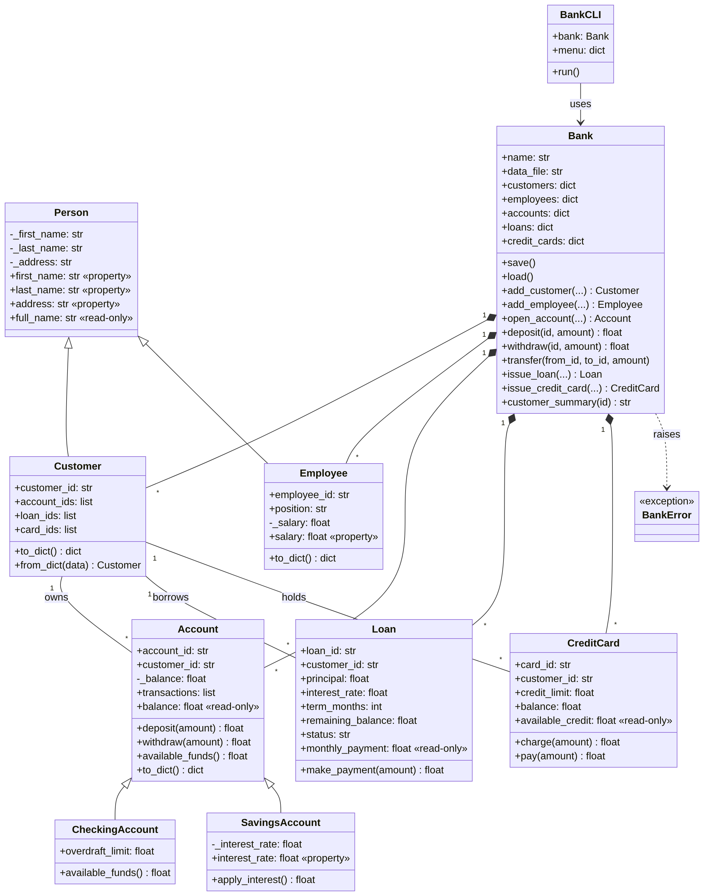

# Banking System (Python OOP Mini-Project)

A simple model of a bank, built with object-oriented Python and run from the
command line. You can add customers and employees, open checking and savings
accounts, deposit, withdraw and transfer money, issue loans and credit cards,
and every change is saved to a JSON file.

## How to run

Requires Python 3.8 or newer. No extra packages are needed.

```bash
python main.py              # start the interactive menu
python -m unittest -v       # run the tests
```

Example session:

```
=== Welcome to Springboard Bank ===
  1. Add customer
  ...
Choose an option: 1
First name: Diane
Last name: W
Address: 12 Elm St
INFO: Added customer C001 (Diane W).
Created [C001] Diane W, 12 Elm St
```

## Project structure

```
banking-system/
├── main.py               # Command-line menu (BankCLI class) - start here
├── bank/
│   ├── people.py         # Person, Customer, Employee
│   ├── accounts.py       # Account, CheckingAccount, SavingsAccount
│   ├── services.py       # Loan, CreditCard
│   ├── bank.py           # Bank: manages everything, saves/loads JSON
│   ├── exceptions.py     # Custom error classes
│   └── logger_config.py  # Logging to screen and to logs/bank.log
├── data/bank_data.json   # Saved bank data (created on first run)
├── logs/bank.log         # Warnings and errors (created on first run)
├── docs/uml_diagram.png  # UML class diagram (source: docs/uml.mmd)
└── tests/test_bank.py    # Unit tests
```

## Class design



| Class | Purpose | Key properties / methods |
|---|---|---|
| `Person` | Base class for anyone with a name and address | `first_name`, `last_name`, `address` (getters/setters), `full_name` |
| `Customer(Person)` | A bank customer | `customer_id`, lists of their account, loan and card IDs |
| `Employee(Person)` | A bank employee | `employee_id`, `position`, `salary` (validated setter) |
| `Account` | Base account | `balance` (read only), `deposit()`, `withdraw()`, transaction history |
| `CheckingAccount(Account)` | Everyday account | `overdraft_limit` (default $100) |
| `SavingsAccount(Account)` | Interest-earning account, no overdraft | `interest_rate`, `apply_interest()` |
| `Loan` | Money lent to a customer | `principal`, `interest_rate`, `term_months`, `make_payment()`, `monthly_payment` |
| `CreditCard` | Revolving credit | `credit_limit`, `charge()`, `pay()`, `available_credit` |
| `Bank` | Holds all objects and saves them | `open_account()`, `transfer()`, `issue_loan()`, `save()`, `load()` ... |
| `BankCLI` | The text menu | `run()` |

### OOP concepts used

- **Encapsulation:** attributes are stored as `_name` and accessed through
  `@property` getters and setters that validate data. An account's `balance`
  has a getter but no setter, so it can only change through `deposit()` or
  `withdraw()`, which also record each transaction.
- **Inheritance:** `Customer` and `Employee` share `Person`'s code;
  `CheckingAccount` and `SavingsAccount` extend `Account`.
- **Polymorphism:** `CheckingAccount` overrides `available_funds()` to add
  its overdraft, so `withdraw()` behaves correctly for each account type
  without any `if` statements on the type.
- **Composition:** the `Bank` *has* customers, accounts, loans etc. stored in
  dictionaries keyed by ID for fast lookup.

### Design decisions

- **Storage: JSON** (`data/bank_data.json`). It is built into Python, easy to
  read in a text editor, and fits nested data such as an account's list of
  transactions. Each class has `to_dict()` / `from_dict()` to convert to and
  from JSON.
- **Save after every change** so nothing is lost if the program crashes. The
  file is written to a temporary file first and then renamed, so a crash
  mid-save can't corrupt the data.
- **Customers store IDs, not objects.** This avoids saving the same account
  twice and keeps the JSON flat and simple.
- **Readable IDs** (`C001`, `A001`, `L001`, `CC001`, `E001`) are generated
  automatically.
- **Simple interest** for loans and monthly interest for savings keep the
  math easy to check.

## Logging

`bank/logger_config.py` sets up one logger with two handlers:

- **Screen:** `INFO` and above, e.g. `INFO: Deposited 500 into A001.`
- **File (`logs/bank.log`):** `WARNING` and above, with timestamps, e.g.
  `2026-11-02 20:54:36 | WARNING | main | Cannot withdraw $800.00; only $600.00 available.`

## Error handling

- Custom exceptions in `bank/exceptions.py` (`InsufficientFundsError`,
  `InvalidAmountError`, `NotFoundError`, `CreditLimitExceededError`) all
  inherit from `BankError`.
- The menu catches `BankError`, logs a warning, and returns to the menu.
- Any unexpected error is logged with its full traceback, but the program
  keeps running.
- If the JSON file is missing or corrupt, the bank logs an error and starts
  empty instead of crashing.

## Style

The code follows PEP-8 (checked with `pycodestyle`) and every class and
function has a docstring.
